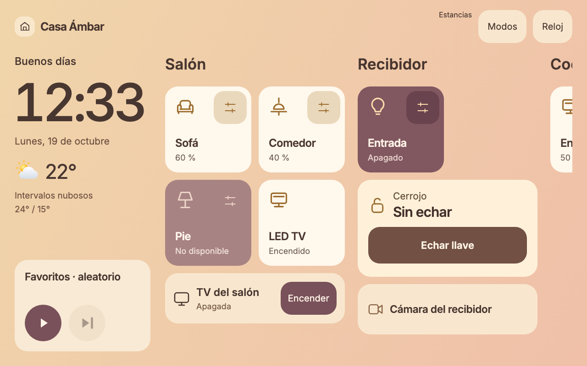
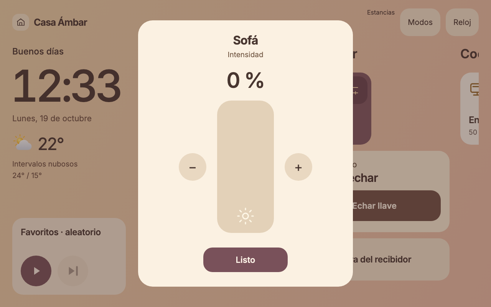
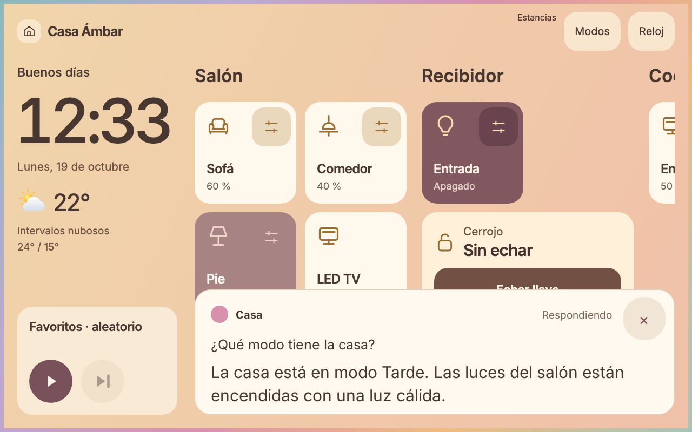

# Casa Ámbar

Panel táctil y automatizaciones de ejemplo para Home Assistant y una pantalla Echo con TECHO5. Diseñado para 1280 × 800: reloj, tiempo, luces cuadradas, estancias mediante desplazamiento horizontal y controles compactos de música. Prioriza salón y recibidor, con repintado incremental y sin animaciones, transiciones ni desenfoques.

Esta distribución pública contiene datos de demostración. No incluye configuración privada, credenciales, capturas de una instalación doméstica ni su historial. Los identificadores de dispositivos son ejemplos que debes adaptar antes de instalar.

## Así se ve

Capturas con datos simulados a 1280 × 800; no son imágenes de una vivienda real.

**Panel principal:** salón y recibidor, reloj, tiempo y controles de música.

| Ajuste de intensidad | Asistente de voz integrado |
| --- | --- |
|  |  |

La imagen de voz procede de una prueba sintética del parche nativo experimental. Consulta sus [requisitos y limitaciones](firmware/techo5/README.md) antes de instalarlo.

## Versiones

La primera release es [v0.1.0](https://github.com/guillermo-angeles/casa-ambar/releases/tag/v0.1.0), experimental. La versión del proyecto identifica el conjunto de fuentes; tarjeta, dashcast e integraciones mantienen sus versiones internas. Consulta [CHANGELOG.md](CHANGELOG.md) para los cambios y [el proceso de releases](docs/VERSIONES.md) para publicar versiones futuras.

Los despliegues requieren una etiqueta concreta: `tools/deploy.sh --version v0.1.0`. Antes de conectar con HA puedes comprobar el checkout con `tools/deploy.sh --version v0.1.0 --check`. Revisa primero [la preparación de una instalación](docs/DESPLIEGUE.md): los identificadores son ejemplos y las adaptaciones requieren una versión propia.

## Probar en local

1. Con Docker disponible, ejecuta `test/docker/run.sh`. Comprueba configuración, arranca HA con dispositivos simulados y ejecuta escenarios; debe terminar con `FALLOS: []`. Usa su propio proyecto Docker y publica solo `127.0.0.1:18124`.
2. Ejecuta `/usr/bin/python3 -I -m unittest discover -s test/tools`. Para dashcast: `cd apps/dashcast/src && go test -race ./...` con Go 1.26, o utiliza un contenedor Go.
3. Abre `test/echo-v5/index.html` para la tarjeta con servicios simulados. Para el prototipo de voz: `python3 -m http.server 18766 --bind 127.0.0.1` y abre `http://127.0.0.1:18766/test/echo-voz/`. Estas demos no controlan HA.

## Componentes

| Ruta | Contenido |
| --- | --- |
| `config/` | Paquetes YAML, dashboards, tarjeta y prompt de ejemplo |
| `apps/dashcast/` | App de HA que retransmite el dashboard a TECHO5 |
| `custom_components/casa_groq_stt/` | Adaptador de transcripción Groq |
| `custom_components/hass_nuki_bt/` | Integración Nuki Bluetooth de terceros |
| `firmware/techo5/` | Parche experimental de interfaz de voz sobre TECHO5 |
| `test/` | HA simulado y pruebas de interfaz y herramientas |
| `tools/` | Acceso, despliegue con copia y comprobación, reversión y medidas |

Consulta [el contrato de ejemplo](docs/CONTRATO.md), [la instalación y reversión](docs/DESPLIEGUE.md) y [las licencias de terceros](THIRD_PARTY_NOTICES.md). La rama de firmware requiere compilar fuentes y validación física independiente; las pruebas de navegador no demuestran fluidez ni funcionamiento del micrófono en un Echo.

## Voz y seguridad

El pipeline combina intenciones locales de HA, Whisper local o Groq para transcribir, un agente Anthropic y Piper local para sintetizar. Los servicios externos requieren sus propias cuentas y pueden tener coste. El ejemplo de configuración del agente debe revisarse contra la versión de HA y el catálogo que ofrezca tu cuenta; no representa un compromiso de disponibilidad de modelos o precios.

La cerradura no se abre desde la pantalla, por voz ni mediante automatizaciones. El cierre desde la pantalla requiere confirmación. Cerraduras y cámaras quedan fuera de las entidades expuestas al agente. No expongas HA a internet: usa acceso local o una VPN. Introduce las claves de proveedores en la interfaz de HA; las herramientas de macOS leen el token de acceso de su Llavero.

## Colaborar

Las correcciones, mejoras de accesibilidad, pruebas y documentación son bienvenidas. Consulta [cómo contribuir](CONTRIBUTING.md) y el [historial de cambios](CHANGELOG.md).

## Licencia

Código propio bajo [MIT](LICENSE). Se conservan las licencias y atribuciones de TECHO5, hass_nuki_bt, pyNukiBT e Inter en sus directorios. Proyecto independiente, sin afiliación con Apple, Amazon, Home Assistant o proveedores de IA.
